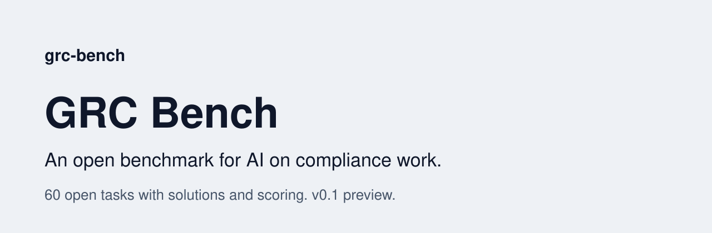

<picture>
  <source media="(prefers-color-scheme: dark)" srcset="assets/banner-dark.svg">
  <source media="(prefers-color-scheme: light)" srcset="assets/banner-light.svg">
  
</picture>

[](LICENSE.md) [](LICENSE.md) [](METHOD.md) [](questions.jsonl) [](DATASHEET.md) [](AGENTS.md) [](https://www.ismscopilot.com/benchmark?ref=grc-bench-readme)

# GRC Bench

An open benchmark for AI on governance, risk and compliance work, by ISMS Copilot.

**Preview v0.1. A vendor-authored candidate task suite and draft scoring method. It has not been calibrated on models, is not evidence of comparative performance, and should not be used to rank systems yet.**

**Reference answers are provisional benchmark keys, not legal advice or operational instructions. Verify current authoritative sources before relying on them.**

Published by Better ISMS EURL, maker of ISMS Copilot. We sell an AI product for this work, and it will be an entry. Read [METHOD.md](METHOD.md) for what that means and what we commit to.

## The one prompt

Paste this into your AI agent:

> Read github.com/better-isms/grc-bench and run GRC Bench on the AI I use. Tell me where it loses points.

It follows [AGENTS.md](AGENTS.md): it answers the 60 questions without seeing the solutions, then scores the answers with two outside judge models you choose (your API keys).

## What is here

- `questions.jsonl`: the 60 tasks with the solutions removed, for whoever is being tested.
- `tasks/`: the tasks, reference answers and scoring criteria. Reference answers are provisional.
- `AGENTS.md`: steps for an AI agent asked to run GRC Bench on itself.
- `METHOD.md`: how it works and the rules we hold ourselves to.
- `DATASHEET.md`: what it measures, coverage, how tasks were written, known limits.
- `ERRATA.md`: every correction.
- `src/`: a small command line kit with no dependencies.

## How to run it

Two ways. Both are unofficial runs of a preview, and both need two judge models from model families other than the one tested, each with its own API key.

**Ask your AI agent.** Give it this repository and say: "Run GRC Bench on yourself and tell me where you lose points." It follows [AGENTS.md](AGENTS.md): it answers `questions.jsonl` (the 60 tasks with the solutions removed) without opening the solutions, then scores its answers with the two judges you give it.

**Run a model through its API.** Needs Node 22.18 or later and an OpenAI-compatible chat completions endpoint. Use benchmark-only keys with a spend limit.

The kit contacts only the endpoints you configure:

- Model endpoint: your API key, the model name, a short system prompt and each task with its documents.
- Judge endpoints: their API keys, the model name, the task, reference answer, criteria and the model's answer.

```bash
node src/cli.ts validate --tasks tasks

export GRCBENCH_API_KEY=...
node src/cli.ts run --endpoint https://your-endpoint/v1 --model your-model \
  --out answers.jsonl --max-calls 60

export GRCBENCH_JUDGE_A_KEY=... GRCBENCH_JUDGE_B_KEY=...
node src/cli.ts judge-check --tasks tasks --max-calls 24 \
  --judge-a-endpoint https://... --judge-a-model ... \
  --judge-b-endpoint https://... --judge-b-model ...
node src/cli.ts score --answers answers.jsonl --out score.json --max-calls 120 \
  --judge-a-endpoint https://... --judge-a-model ... \
  --judge-b-endpoint https://... --judge-b-model ...

node src/cli.ts compare --current score-a.json --candidate score-b.json
```

Your results are unofficial. There are no official scores yet, and results from different judges or versions are not comparable.

## Licence

Code: MIT. Original task text and documentation by Better ISMS: CC BY 4.0. That licence does not cover third-party names, marks, identifiers, titles, quotes or source material. See [LICENSE.md](LICENSE.md) and `provenance.json`.

ISO and SOC 2 are marks of their owners, used only to name the standard and examination. Not affiliated with or endorsed by ISO, IEC, AICPA, NIST or any regulator or standards body.
